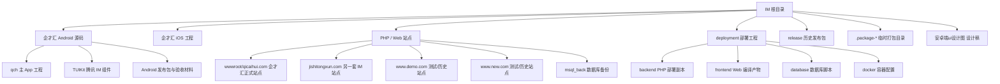

# IM 目录项目清单

## 项目树

## 一、真正的源码项目

| 项目 | 路径 | 类型 | 用途 |
| --- | --- | --- | --- |
| 企才汇 Android 主 App | `企才汇IM源代码安卓/qch` | Gradle Android 工程 | 企才汇安卓客户端业务代码 |
| 腾讯 IM Android 组件 | `企才汇IM源代码安卓/TUIKit` | Android 多模块库 | 会话、聊天、联系人、通话等 IM 通用能力 |
| 企才汇 iOS | `企才汇ios/TUIKitDemo` | Xcode 工程 | 企才汇 iOS 客户端 |
| 企才汇 PHP 正式站点 | `wwwroot/qicaihui.com` | ThinkPHP 5.1 | PHP API、后台、PHP 页面模板和静态资源 |

### Android 内部关系

`qch` 是主 App，`TUIKit` 是它引用的组件源码。两者共同组成企才汇 Android 项目，不能只拿 `qch` 单独当完整工程。

`企才汇IM源代码安卓/release` 只是 APK、mapping、日志等发布资料，不是 Android 源码项目。

## 二、Web/PHP 相关目录

| 目录 | 定位 | 是否建议作为主开发目录 |
| --- | --- | --- |
| `wwwroot/qicaihui.com` | 企才汇正式 ThinkPHP 站点 | 是，PHP/API/传统模板修改在这里 |
| `deployment/backend` | 从正式站点组装出的部署副本 | 否，由打包流程生成 |
| `deployment/frontend/public` | Web 编译后的 HTML/JS/CSS/图片 | 否，当前没有完整前端工程源码 |
| `wwwroot/jishitongxun.com` | 另一套 IM PHP 站点 | 仅在确认属于本项目时修改 |
| `wwwroot/www.demo.com` | 测试或历史站点副本 | 否 |
| `wwwroot/www.new.com` | 测试或历史站点副本 | 否 |
| `wwwroot/msql_back` | 数据库备份 | 否 |

## 三、发布、部署和资料目录

- `deployment`：可部署工程，包含 PHP 后端副本、Web 静态产物、数据库迁移、Docker/Caddy 配置和脚本。
- `release`：历史 APK、Web 更新包、部署 ZIP、mapping、截图等发布材料。
- `.package-*`：打包过程产生的临时目录，每个目录内通常是一个 `YCH-IM-deploy` 包。
- `安卓端ui设计图`：安卓页面设计图，不是可编译源码。
- `.tools`：本机 SDK、JDK、PHP、构建脚本、测试截图和运行日志，不是业务项目。

## 四、容易混淆的独立项目

`ShangLuoSuLian` 是另一套独立的 Android IM 工程，拥有自己的 `app`、`wk*` 模块和 Gradle 配置；它不属于 `企才汇IM源代码安卓/qch + TUIKit` 这套企才汇客户端。

## 给老板的一句话

目前 IM 目录里可以按“4 个源码项目 + 1 套部署工程 + 1 套独立 Android 工程 + 若干发布/测试资料”理解：

1. 企才汇 Android：`qch + TUIKit`
2. 企才汇 iOS：`企才汇ios/TUIKitDemo`
3. 企才汇 PHP/Web：`wwwroot/qicaihui.com`
4. 另一套 PHP IM：`wwwroot/jishitongxun.com`
5. 企才汇部署工程：`deployment`
6. 独立 Android 工程：`ShangLuoSuLian`
